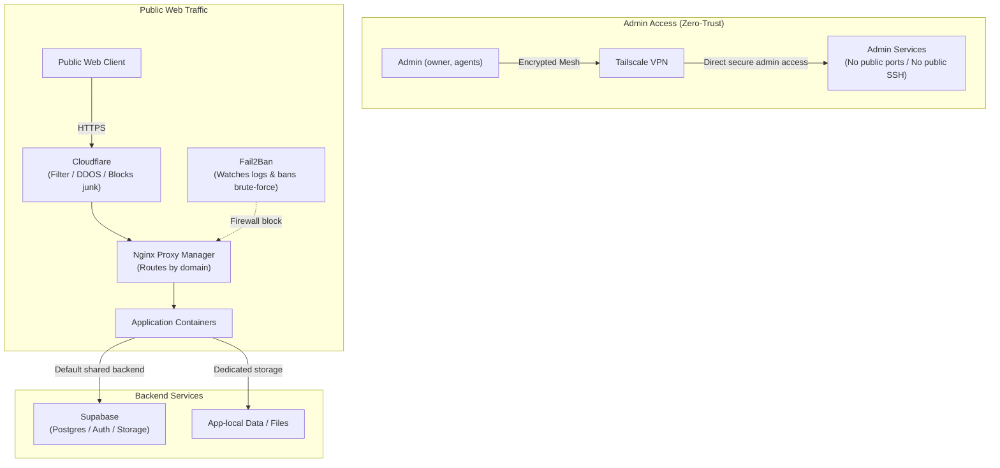

# Homelab Dashboard

Welcome to the homelab vault. One physical bare-metal server runs isolated virtual machines via XCP-ng, alongside a remote VPS running Dokploy. The goal is reproducible, zero-trust infrastructure where all configuration is managed from code.

> [!NOTE]
> This vault prototype reshapes repo presentation for Obsidian and GitHub. No secrets are stored in this repository; all credentials live in OpenBao.

---

## Vault Navigation

| Area | Purpose | Link |
|---|---|---|
| **Inventory** | What exists: services, machines, network | [inventory/](inventory/README.md) |
| **Systems** | How each system works and rules | [systems/](systems/README.md) |
| **Plans** | Work in flight and migration steps | [plans/](plans/README.md) |
| **Decisions** | Architecture decisions and reasoning | [decisions/](decisions/README.md) |
| **Open Questions** | Undecided or unverified items | [decisions/open-questions.md](decisions/open-questions.md) |
| **Skills** | Operational runbooks and agent procedures | [skills/](skills/README.md) |
| **Journal** | Log of changes and operational events | [journal/](journal/README.md) |
| **Repo Guide** | Rules, layout, and how to work here | [AGENTS.md](AGENTS.md) · [README.md](README.md) |

### Standalone Bases Views
- [Systems Base](bases/systems.base)
- [Inventory Base](bases/services.base)
- [Plans Base](bases/plans.base)

---

## Traffic Flow

Visual model of traffic ingress and backend connections, derived from [inventory/network.md](inventory/network.md):



---

## Systems Overview

```base
filters:
  and:
    - file.inFolder("systems")
    - 'type == "system"'
views:
  - type: table
    name: Systems
    order:
      - file.name
      - status
      - verified
      - hosts
      - tags
```

---

## Active Plans

```base
filters:
  and:
    - file.inFolder("plans")
    - 'type == "plan"'
views:
  - type: table
    name: Plans
    order:
      - file.name
      - status
      - verified
      - hosts
      - related
      - tags
```

---

## Inventory Overview

```base
filters:
  and:
    - file.inFolder("inventory")
views:
  - type: table
    name: Inventory
    order:
      - file.name
      - type
      - status
      - verified
      - hosts
      - tags
```
