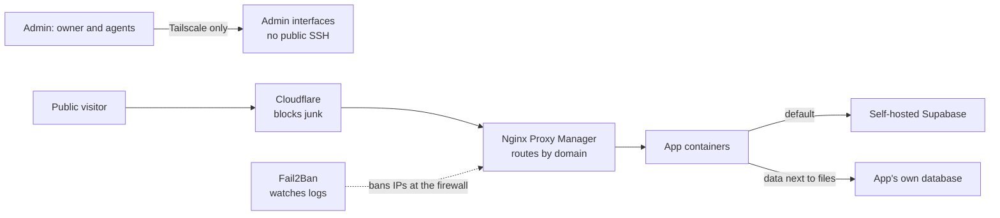

# Network

This file owns every IP address. Hosts are named as in `hosts.md`; what runs
on each is in `services.md`.

**Source:** from the docs and not verified, unless a row's State says
`verified: …`.

Private subnet `10.22.33.0/24`, served by the Home router
(`systems/router.md`).

| IP | Host | State |
|---|---|---|
| `.1` | Home router: gateway, DHCP, DNS | verified: `uci show network` over SSH 2026-11-13 |
| `.100`–`.249` | DHCP pool, 12-hour leases | verified: `uci show dhcp` over SSH 2026-11-13 |
| `.252` | oob-1, static, outside the DHCP pool (`systems/oob.md`) | verified: `ip -br a` over SSH 2026-11-14 |
| `.254` | Docker + proxy host | in docs; an address answers here (`ip neigh` on the router 2026-11-13), which machine it is was not checked |
| `.55` | portainer instance | verified: SSH and Portainer API 2026-11-14 |
| `.99` | NPM-set | verified: SSH and Portainer API 2026-11-14 |
| `.100` | Xen Orchestra (`xo-ce`) | verified: its REST API answered 2026-11-14 |
| `.123` | gpu_docker | verified: SSH 2026-11-14 |
| `.160` | TrueNAS VM | verified: TrueNAS API 2026-11-14 |
| `.253` | adguard-docker | verified: SSH and Portainer API 2026-11-14 |

Upstream of the Home router is the ISP router's own private network,
`192.168.1.0/24`: the Home router takes an address there by DHCP and the ISP
router is its gateway (`uci show network`, `ip route`, 2026-11-13).

Oracle Cloud network for `iac/oci/`: `10.40.0.0/16`, subnet `10.40.1.0/24`
(`iac/oci/network.tf`, applied 2026-11-06). Machines there are reached over
Tailscale; their public addresses are not recorded in this repo.

## How traffic flows

- Admin (me, agents): only over Tailscale, a private mesh VPN between my
  devices. Nothing admin-facing listens on the public internet. No public SSH.
- Public web: Cloudflare (blocks junk) -> Nginx Proxy Manager (routes by
  domain) -> the right container. Fail2Ban watches logs and bans brute-force
  IPs at the firewall.
- Default app backend: self-hosted Supabase (shared Postgres/auth/storage for
  small apps), unless the app needs its database close to its files (then the
  metadata moves next to it).

Open item: no external "is my whole host down?" monitor yet.
