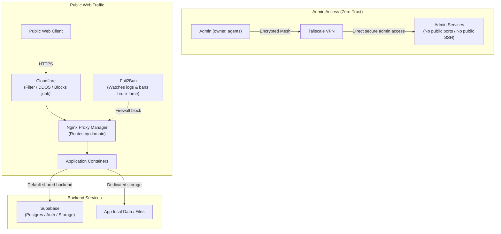

# Network

This file owns every IP address. Hosts are named as in `hosts.md`; what runs
on each is in `services.md`.

**Source:** from the docs, not verified against the router.

Private subnet `10.22.33.0/24`.

| IP | Host |
|---|---|
| `.1` | router / gateway |
| `.254` | Docker + proxy host |
| `.160` | TrueNAS VM |

## How traffic flows

- Admin (me, agents): only over Tailscale, a private mesh VPN between my
  devices. Nothing admin-facing listens on the public internet. No public SSH.
- Public web: Cloudflare (blocks junk) -> Nginx Proxy Manager (routes by
  domain) -> the right container. Fail2Ban watches logs and bans brute-force
  IPs at the firewall.
- Default app backend: self-hosted Supabase (shared Postgres/auth/storage for
  small apps), unless the app needs its database close to its files (then the
  metadata moves next to it).

Open item: no external "is my whole host down?" monitor yet.
