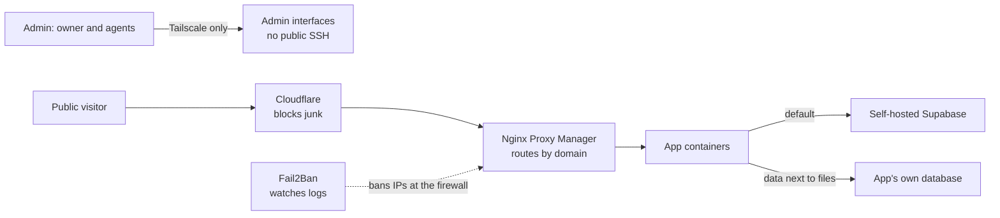

# Network

This file owns every IP address. Hosts are named as in `hosts.md`; what runs
on each is in `services.md`.

**Source:** from the docs and not verified, unless a row's State says
`verified: …`.

Private subnet `10.22.33.0/24`, served by the Home router
(`lab/systems/router.md`).

| IP | Host | State |
|---|---|---|
| `.1` | Home router: gateway, DHCP, DNS | verified: `uci show network` over SSH |
| `.10`–`.54` | DHCP pool, 12-hour leases. Addresses above `.100` are free for fixed addresses set by each machine; it stops at `.54` to stay clear of `.55`, `.99` and `.100`, which are set on their machines. The router has no DHCP reservations | verified: `uci show dhcp` and the generated `dhcp-range` over SSH |
| `.252` | oob-1, static, outside the DHCP pool (`lab/systems/oob.md`) | verified: `ip -br a` over SSH |
| `.254` | apt-cache (apt-cacher-ng, no Docker) | verified: SSH |
| `.55` | portainer instance | verified: SSH and Portainer API |
| `.99` | NPM-set | verified: SSH and Portainer API |
| `.100` | Xen Orchestra (`xo-ce`) | verified: its REST API answered |
| `.137` | cache VM `cache-1` (`agents/plans/package-and-image-cache.md`); set on the VM by OpenTofu and cloud-init | verified: over SSH `eth0` at `.137/24`, and Xen Orchestra's agent reported it (`agents/journal/2026-11-16-build-cache-1.md`) |
| `.138` | home reverse proxy `proxy-1` (`apps/homeserver/traefik/`); set on the VM by OpenTofu and cloud-init. The public record `*.home.<zone>` points here | verified: over SSH `eth0` at `.138/24`, and the router's dnsmasq answering `cache.home.<zone>` with it (`agents/journal/2026-11-18-build-proxy-1-traefik.md`) |
| `.123` | gpu_docker | verified: SSH |
| `.160` | TrueNAS VM | verified: TrueNAS API |
| `.253` | adguard-docker | verified: SSH and Portainer API |

**When each check ran** (the State cells say how):

- Home router (`.1`): 2026-11-13 (`agents/journal/2026-11-13-openwrt-home-router.md`).
  The DHCP pool (`.10`–`.54`): 2026-11-16, when it was narrowed from
  `.100`–`.249` at the owner's request.
- oob-1 and the home VMs (`.55`, `.99`, `.100`, `.123`, `.160`, `.252`–`.254`):
  the read-only recon of 2026-11-14.
- cache-1 (`.137`): 2026-11-16. proxy-1 (`.138`): 2026-11-18. Both in the linked
  journal entries.

Upstream of the Home router is the ISP router's own private network,
`192.168.1.0/24`: the Home router takes an address there by DHCP and the ISP
router is its gateway (`uci show network`, `ip route`, 2026-11-13).

Oracle Cloud network for `iac/oci/`: `10.40.0.0/16`, subnet `10.40.1.0/24`
(`iac/oci/network.tf`, applied 2026-11-06). Machines there are reached over
Tailscale; their public addresses are not recorded in this repo.

## How traffic flows

- Admin (me, agents): only over Tailscale, a private mesh VPN between my
  devices. Nothing admin-facing listens on the public internet. No public SSH.
- Public web: Cloudflare (blocks junk) -> Nginx Proxy Manager (routes by
  domain) -> the right container. Fail2Ban watches logs and bans brute-force
  IPs at the firewall.
- Default app backend: self-hosted Supabase (shared Postgres/auth/storage for
  small apps), unless the app needs its database close to its files (then the
  metadata moves next to it).

Open item: no external "is my whole host down?" monitor yet.
